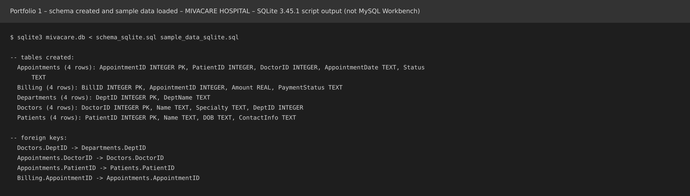

# Portfolio 1 – Database Design and Modelling (MIVACARE HOSPITAL)

## Case study (selected organisation)
**Organisation:** MIVACARE HOSPITAL – a simulated general hospital.
**Nature of system:** Hospital Management System covering outpatient appointments and billing.
**Users:** receptionists (register patients, book appointments), doctors (view appointments/history), billing officers (record payments), hospital administrators (reports).
**Major data stored:** departments, doctors, patients, appointments, billing records.
**Key operations:** register patient, book/cancel appointment, retrieve patient history, record payment, report revenue per department.

## Contents
| Item | File |
|---|---|
| ER diagram (Mermaid) | [diagrams/ER_Diagram.md](diagrams/ER_Diagram.md) |
| ER diagram (image) | [diagrams/ERDiagram_mivacare.png](diagrams/ERDiagram_mivacare.png) |
| Relational schema, keys, constraints | [sql/](sql/) (MySQL, PostgreSQL, SQL Server, SQLite) |
| Sample data | `sql/sample_data_*.sql` |
| Design explanation | [schema_notes.md](schema_notes.md) |

## Keys and constraints
- **PKs:** DeptID, DoctorID, PatientID, AppointmentID, BillID.
- **FKs:** Doctors.DeptID→Departments; Appointments.PatientID→Patients; Appointments.DoctorID→Doctors; Billing.AppointmentID→Appointments (UNIQUE, giving 1:1).
- **Constraints:** NOT NULL, UNIQUE(DeptName), CHECK on Status and PaymentStatus, CHECK(Amount >= 0), ON DELETE RESTRICT.

## Normalisation
- **1NF:** all columns atomic, every table has a PK. (`ContactInfo` stores email and phone together; splitting it into `Email` and `Phone` would be the next 1NF improvement.)
- **2NF:** every table has a single-column PK, so no partial dependencies.
- **3NF:** non-key attributes depend only on their table's key (e.g. department name lives only in Departments, not repeated in Doctors).

## How to run (MySQL)
```sql
SOURCE sql/schema_mysql.sql;
SOURCE sql/sample_data_mysql.sql;
```
Tested here by running the SQLite versions end-to-end; MySQL/PostgreSQL/SQL Server scripts were not executed in this environment.

## Evidence

