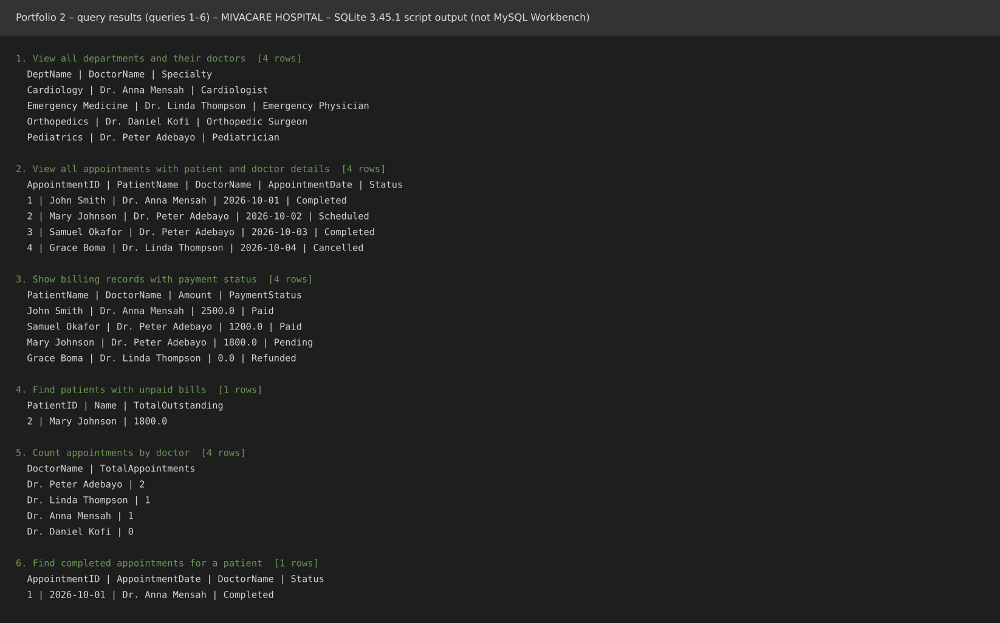
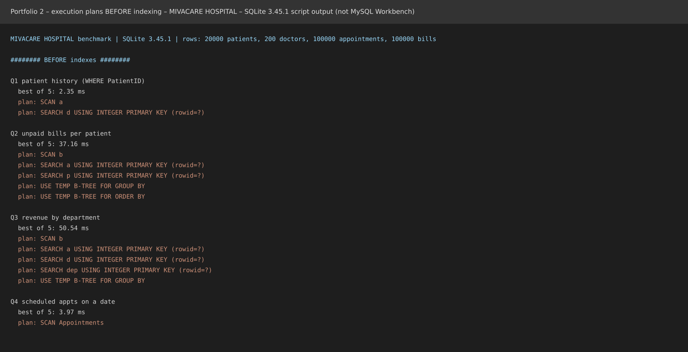
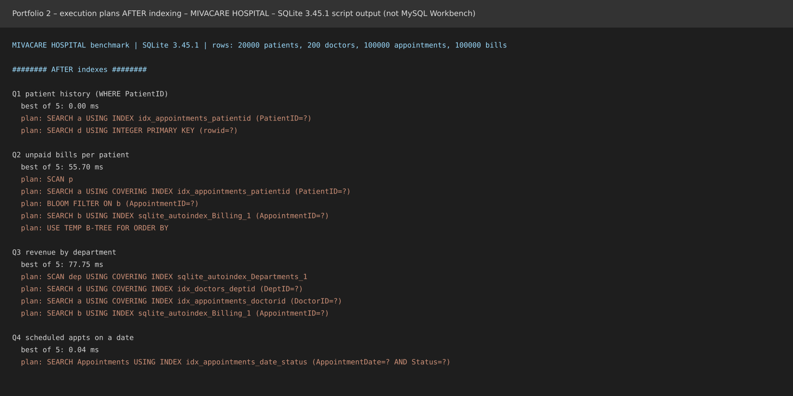
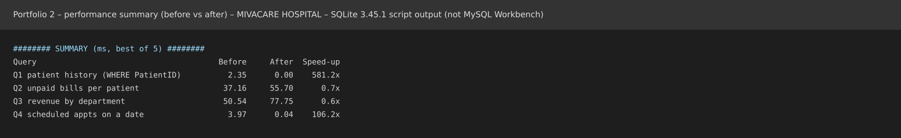

# Portfolio 2 – Query Processing and Optimisation (MIVACARE HOSPITAL)

| Item | File |
|---|---|
| Eight reporting queries | [hospital_queries.sql](hospital_queries.sql) |
| Benchmark and execution-plan script | [benchmark_sqlite.py](benchmark_sqlite.py) |
| Captured output | [results/benchmark_output.txt](results/benchmark_output.txt) |

## Method
`benchmark_sqlite.py` loads the schema, generates 20,000 patients, 200 doctors, 100,000 appointments and 100,000 bills (fixed random seed), drops the secondary indexes, records `EXPLAIN QUERY PLAN` and best-of-5 timings, adds indexes, runs `ANALYZE` and measures again.

## Results (SQLite 3.45.1)
| Query | Before (ms) | After (ms) | Plan change |
|---|---|---|---|
| Q1 patient history | 2.35 | <0.01 | `SCAN a` → `SEARCH … idx_appointments_patientid` |
| Q4 scheduled on a date | 3.97 | 0.04 | `SCAN` → `SEARCH … idx_appointments_date_status` (composite) |
| Q2 unpaid bills per patient | 37.16 | 55.70 | different join order; slightly slower |
| Q3 revenue by department | 50.54 | 77.75 | different join order; slightly slower |

## Analysis
- Selective lookups (Q1, Q4) improve by two to three orders of magnitude because a full table scan becomes a B-tree search.
- Q2 and Q3 aggregate most of the table, so indexes cannot skip much work. The planner switched join order and was slightly slower on this data. Timings are from one machine and an in-memory database, so treat them as indicative; re-run `EXPLAIN` in MySQL Workbench on your own data.
- Trade-off: each index costs storage and slows INSERT/UPDATE, so index the columns used in frequent WHERE/JOIN clauses, not everything.

## Evidence images (SQLite output)

These are from SQLite, not MySQL; running `EXPLAIN` in MySQL Workbench would give the equivalent for MySQL.
